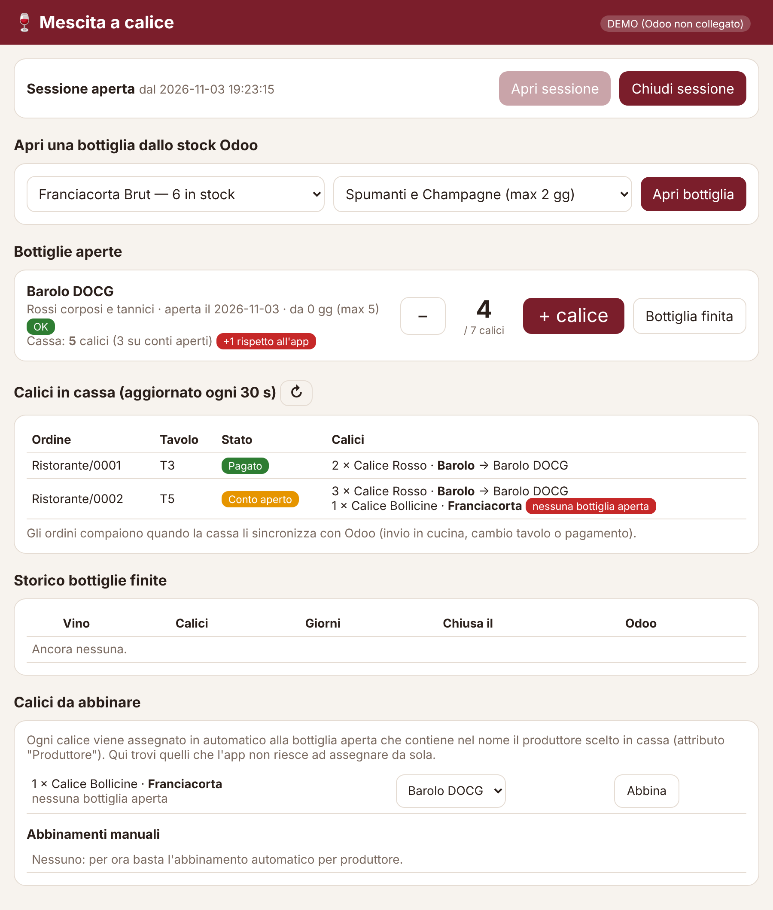

# Mescita a calice

Web app per controllare le bottiglie aperte per la vendita a calice, collegata allo stock di Odoo.



## Come funziona
1. **Apri sessione** a inizio servizio.
2. **Apri bottiglia**: scegli un vino dallo stock Odoo e la sua categoria (la categoria viene ricordata per le volte successive).
3. **+ calice** a ogni calice venduto (− per correggere).
4. **Bottiglia finita** quando è vuota: compare l'anteprima della faccina (😊 se 7 calici esatti, 😠 altrimenti).
5. **Chiudi sessione** a fine giornata: solo ora le bottiglie finite vengono scaricate dall'inventario Odoo. Le altre restano aperte e il giorno dopo si vede da quanti giorni sono aperte, con avviso se superano la durata della categoria.

| Categoria | Durata (giorni) |
|---|---|
| Spumanti e Champagne | 1–2 |
| Bianchi leggeri e rosati | 2–3 |
| Bianchi corposi / legno | 2–3 |
| Rossi leggeri | 1–3 |
| Rossi corposi e tannici | 4–5 |
| Dolci, liquorosi, passiti | 7–28 |

Badge: verde = OK, arancione = tra min e max (da finire presto), rosso = oltre la durata massima.
Durate e calici per bottiglia si cambiano in `categorie.py`.

## Collegamento a Odoo
Usa l'API XML-RPC standard (Odoo 14–18). Legge `stock.quant` per le giacenze e, alla chiusura, fa una rettifica di inventario (−1) sul prodotto. Crea un utente Odoo dedicato con permessi di magazzino e una chiave API. Senza `ODOO_URL` l'app gira in **modalità demo** con un magazzino finto.

## Avvio in locale
```bash
python3 -m venv venv && . venv/bin/activate
pip install -r requirements.txt
cp .env.example .env   # e compila
set -a; . ./.env; set +a
uvicorn app:app --port 8765
```

## Installazione sulla VPS (mescita.profumidistria.com)
```bash
sudo mkdir -p /opt/mescita-app && sudo cp -r . /opt/mescita-app && cd /opt/mescita-app
sudo python3 -m venv venv && sudo venv/bin/pip install -r requirements.txt
sudo cp .env.example .env && sudo nano .env          # credenziali Odoo + MESCITA_PASSWORD
sudo chown -R www-data /opt/mescita-app
sudo cp deploy/mescita.service /etc/systemd/system/ && sudo systemctl enable --now mescita
sudo cp deploy/nginx-mescita.conf /etc/nginx/sites-enabled/mescita && sudo nginx -t && sudo systemctl reload nginx
sudo certbot --nginx -d mescita.profumidistria.com   # HTTPS
```
Il database è il file `mescita.db` (SQLite): fanne un backup periodico.

## Calici in tempo reale dalla cassa (POS Odoo)
L'app legge le righe d'ordine del POS di Odoo, anche dei conti non ancora pagati, e per ogni bottiglia aperta mostra quanti calici sono stati battuti in cassa dal momento dell'apertura, confrontandoli con i calici segnati nell'app. La tabella "Calici in cassa" elenca ogni ordine con tavolo e stato (conto aperto / pagato) e si aggiorna ogni 30 secondi.

Ogni riga POS di un calice (prodotti della categoria `ODOO_CALICE_CATEGORY`, es. "Mescita") viene assegnata alla bottiglia aperta tramite l'attributo **Produttore** del calice (vale anche per "Produttore Classico" e "Produttore Charmat"): l'app cerca la bottiglia aperta il cui nome contiene il nome del produttore. Se non ne trova nessuna o ne trova più di una, il calice compare in "Calici da abbinare", dove si può scegliere la bottiglia a mano; l'abbinamento viene ricordato.

Un ordine compare appena la cassa lo sincronizza con Odoo: in modalità ristorante succede a ogni invio in cucina, cambio tavolo o pagamento. L'utente Odoo della web app deve poter leggere il Punto Vendita.
