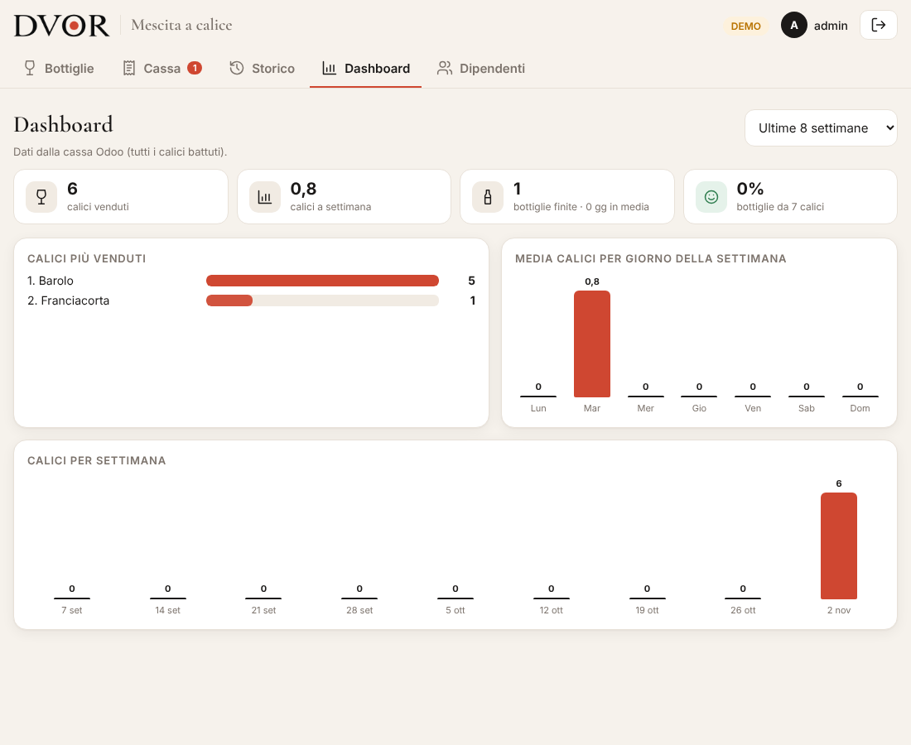

# Mescita a calice

Web app per controllare le bottiglie aperte per la vendita a calice, collegata allo stock di Odoo.


## Come funziona
1. **Apri bottiglia**: scegli un vino dallo stock Odoo e la sua categoria (la categoria viene ricordata per le volte successive).
2. **+ calice** a ogni calice venduto (− per correggere). Accanto vedi i calici battuti in cassa.
3. **Bottiglia finita** quando è vuota: compare un riepilogo con calici segnati, calici in cassa e faccina (😊 se 7 calici esatti, 😠 altrimenti). Solo dopo la conferma di una persona la bottiglia viene scaricata subito dall'inventario Odoo.
4. Nello **Storico** ogni bottiglia ha "OK" con data e ora se Odoo ha confermato lo scarico, altrimenti "Non sincronizzata" con il pulsante Riprova.

Le bottiglie non finite restano aperte e si vede da quanti giorni lo sono, con avviso se superano la durata della categoria.

| Categoria | Durata (giorni) |
|---|---|
| Spumanti e Champagne | 1–2 |
| Bianchi leggeri e rosati | 2–3 |
| Bianchi corposi / legno | 2–3 |
| Rossi leggeri | 1–3 |
| Rossi corposi e tannici | 4–5 |
| Dolci, liquorosi, passiti | 7–28 |

Badge: verde = OK, arancione = tra min e max (da finire presto), rosso = oltre la durata massima.
Durate e calici per bottiglia si cambiano in `categorie.py`.

## Dashboard (amministratore)
Calici più venduti (per produttore), media calici per giorno della settimana e calici per settimana, su 4, 8, 12 o 26 settimane. I dati arrivano dalla cassa Odoo; se la cassa non è raggiungibile usa i calici segnati nell'app. Mostra anche le bottiglie finite, i giorni medi di apertura e la percentuale di bottiglie da 7 calici.



## Accesso e dipendenti
Ogni persona entra con **nome e PIN**. Al primo avvio l'app crea l'amministratore `admin` con password uguale a `MESCITA_PASSWORD` del `.env` (o `0000` se vuota): entra, cambia il PIN da "Dipendenti" in fondo alla pagina e aggiungi i dipendenti. L'amministratore può aggiungere, disattivare/riattivare e cambiare il PIN di ognuno. L'app registra chi apre e chi chiude ogni bottiglia e chi segna i calici.

## Avviso bottiglie costose
Se il costo del prodotto in Odoo (`standard_price`, configurabile con `ODOO_CAMPO_PREZZO`) supera `MESCITA_SOGLIA_PREZZO` (45 € di default), prima di aprire la bottiglia l'app chiede una conferma. La bottiglia resta segnata con 💶 e il nome di chi l'ha aperta, anche nello storico.

## Collegamento a Odoo
Usa l'API XML-RPC standard (Odoo 14–18). Legge `stock.quant` per le giacenze e, alla chiusura, fa una rettifica di inventario (−1) sul prodotto. Crea un utente Odoo dedicato con permessi di magazzino e una chiave API. Senza `ODOO_URL` l'app gira in **modalità demo** con un magazzino finto.

## Avvio in locale
```bash
python3 -m venv venv && . venv/bin/activate
pip install -r requirements.txt
cp .env.example .env   # e compila
set -a; . ./.env; set +a
uvicorn app:app --port 8765
```

## Installazione sulla VPS (mescita.profumidistria.com)
```bash
sudo mkdir -p /opt/mescita-app && sudo cp -r . /opt/mescita-app && cd /opt/mescita-app
sudo python3 -m venv venv && sudo venv/bin/pip install -r requirements.txt
sudo cp .env.example .env && sudo nano .env          # credenziali Odoo + MESCITA_PASSWORD
sudo chown -R www-data /opt/mescita-app
sudo cp deploy/mescita.service /etc/systemd/system/ && sudo systemctl enable --now mescita
sudo cp deploy/nginx-mescita.conf /etc/nginx/sites-enabled/mescita && sudo nginx -t && sudo systemctl reload nginx
sudo certbot --nginx -d mescita.profumidistria.com   # HTTPS
```
Il database è il file `mescita.db` (SQLite): fanne un backup periodico.

## Calici in tempo reale dalla cassa (POS Odoo)
L'app legge le righe d'ordine del POS di Odoo, anche dei conti non ancora pagati, e per ogni bottiglia aperta mostra quanti calici sono stati battuti in cassa dal momento dell'apertura, confrontandoli con i calici segnati nell'app. La tabella "Calici in cassa" elenca ogni ordine con tavolo e stato (conto aperto / pagato) e si aggiorna ogni 30 secondi.

Ogni riga POS di un calice (prodotti della categoria `ODOO_CALICE_CATEGORY`, es. "Mescita") viene assegnata alla bottiglia aperta tramite l'attributo **Produttore** del calice (vale anche per "Produttore Classico" e "Produttore Charmat"): l'app cerca la bottiglia aperta il cui nome contiene il nome del produttore. Se non ne trova nessuna o ne trova più di una, il calice compare in "Calici da abbinare", dove si può scegliere la bottiglia a mano; l'abbinamento viene ricordato.

Un ordine compare appena la cassa lo sincronizza con Odoo: in modalità ristorante succede a ogni invio in cucina, cambio tavolo o pagamento. L'utente Odoo della web app deve poter leggere il Punto Vendita.

## Ordini consigliati (solo admin)

La scheda **Ordini** suggerisce cosa ordinare. Le vendite arrivano dai movimenti di magazzino Odoo: bottiglie vendute e bottiglie finite al calice. Le regole sono:

- il livello da raggiungere è la scorta minima (3 bottiglie) più il consumo previsto per le settimane di copertura (2);
- i vini più venduti (i primi 10) si ordinano a casse intere da 6, gli altri a bottiglie singole.

Tutti i parametri si cambiano dalla scheda. La lista si copia o si stampa.

## Autoconsumo

Il pulsante 🎁 sulla scheda di una bottiglia registra i calici che non passano dalla cassa: bevuti dal personale, offerti, assaggi, rotti o versati. Questi calici contano per arrivare ai 7 della bottiglia ma non come venduti. Il riepilogo per motivo e per persona è in **Storico → Autoconsumo**.

## Guida per lo staff

`/static/guida.html` si apre dal pulsante **?** nell'app.
